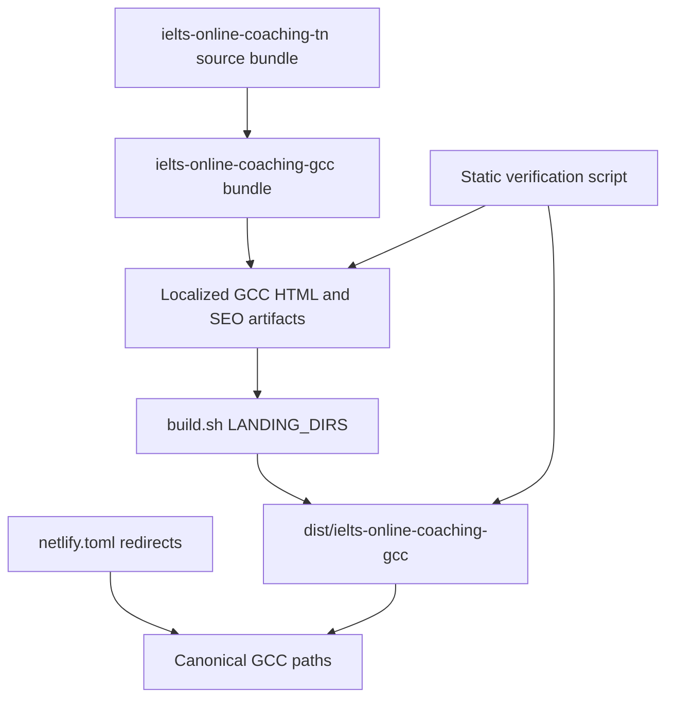

# GCC IELTS Campaign Landing Page - Plan

## Goal Capsule

- **Objective:** Publish one GCC-targeted IELTS coaching campaign at `https://join.kanan.co/ielts-online-coaching-gcc/` for learners in the UAE, Qatar, and Muscat/Oman.
- **Authority:** The confirmed campaign scope and the deployed TN source page are authoritative; preserve the existing visual layout, shared Tally form, GTM, and Umami tracking.
- **Stop conditions:** Do not create country-specific variants, change the form destination, or make unrelated design or lead-routing changes.
- **Execution profile:** Static HTML campaign clone with localized copy and SEO metadata.

---

## Product Contract

### Summary

Create one GCC campaign page instead of separate Qatar, Muscat, and UAE pages.
The page uses the TN campaign’s interaction design and lead form while speaking to the combined GCC audience.

### Problem Frame

The existing Tamil Nadu page is a ready campaign template, but its location-specific content, URL references, and structured data are incorrect for a GCC acquisition campaign.

### Requirements

- R1. Publish exactly one landing page at `/ielts-online-coaching-gcc/` that targets the GCC audience and mentions the UAE, Qatar, and Muscat/Oman where location coverage is described.
- R2. Preserve the TN page’s visual structure, local asset behavior, GTM container, Umami script, CTA interactions, carousels, and the existing Tally form URL.
- R3. Replace Tamil Nadu, TN, Chennai, Coimbatore, Madurai, and India-specific audience language in user-facing copy, image text, metadata, and structured data with accurate GCC campaign language.
- R4. Give the GCC landing and supporting thank-you page self-referential URLs where applicable, and give the landing page GCC-specific canonical, Open Graph, Twitter, JSON-LD, sitemap, robots, and manifest metadata.
- R5. Ensure the static deployment build publishes the new directory and Netlify resolves the canonical, nested, and clean thank-you paths consistently with other IELTS campaign pages.
- R6. Add repeatable static checks that fail when the page’s route, form URL, or location-specific SEO contract drifts.

### Acceptance Examples

- AE1. When a learner opens `/ielts-online-coaching-gcc/`, the hero and supporting sections address GCC learners rather than Tamil Nadu learners while retaining the familiar campaign design and CTA behavior.
- AE2. When a learner opens the canonical page, social crawlers and search engines receive GCC-specific URLs and area coverage rather than TN URLs or India state schema.
- AE3. When either mobile or modal registration opens, it embeds the same approved Tally URL used by the source campaign.

### Scope Boundaries

- **Included:** One GCC route, its static bundle, local SEO artifacts, deployment routing, and automated static verification.
- **Deferred to Follow-Up Work:** Country-specific GCC pages, regional form variants, campaign-specific testimonials, and bespoke GCC visual design.
- **Outside this campaign:** Changes to Tally configuration, lead routing, sales operations, GTM configuration, and shared global page components.

---

## Planning Contract

### Key Technical Decisions

- KTD1. **Use a single GCC directory.** Implement `ielts-online-coaching-gcc/` as the campaign source rather than creating country directories, because the confirmed campaign has one audience, one landing page, and one form.
- KTD2. **Clone the complete TN static bundle before localizing it.** Preserve route-relative images, trainers, testimonials, icons, and supporting metadata so the page remains self-contained and its layout does not silently regress from missing assets.
- KTD3. **Keep the existing Tally form ID.** Both embedded forms retain `5BvVLb`; only their accessible titles become GCC-specific, so the campaign keeps its current lead destination.
- KTD4. **Treat GCC as regional coverage, not a country.** Course schema will identify GCC service coverage and name UAE, Qatar, and Oman/Muscat explicitly instead of falsely representing GCC as one country or reusing Tamil Nadu’s `State` / India hierarchy.
- KTD5. **Make build output intentional.** Add the GCC directory to `LANDING_DIRS`, update Netlify’s static route conventions, and validate source plus generated `dist` output because deployment publishes `dist` rather than the source directory.

### High-Level Technical Design

### Assumptions

- The campaign’s approved user-facing location label is “GCC,” with UAE, Qatar, and Muscat/Oman presented as covered locations.
- The existing Tally form handles post-submission behavior externally; the copied local `thank-you.html` remains an available static fallback rather than a new form-routing integration.
- Current testimonial claims, trainer information, and program features are approved for this GCC campaign; only location context is changing.

### Risks & Dependencies

- The campaign depends on the external Tally embed and on the shared assets referenced through `../ielts-online/`; verify both mobile and modal embeds after deployment.
- `build.sh` mutates source HTML only to add Umami when absent, so copied files should include the existing idempotent analytics tag and avoid duplicate injection.
- The source bundle’s checked-in `dist` content is stale relative to source. Build output must be generated from the new GCC source, not copied from the old TN `dist` folder.

### Sources & Research

- `ielts-online-coaching-tn/index.html` supplies the campaign layout, CTA behavior, schema shape, analytics, and Tally integration to preserve.
- `build.sh` is the static publishing contract; its `LANDING_DIRS` list determines whether a source directory reaches `dist/`.
- `netlify.toml` defines the clean-route, wildcard, and thank-you conventions used by active IELTS pages.

---

## Implementation Units

### U1. Create the GCC static campaign bundle

- **Goal:** Establish a complete GCC source directory from the TN campaign so every route-relative asset and support file needed by the landing page is available.
- **Requirements:** R1, R2, R4.
- **Dependencies:** None.
- **Files:** `ielts-online-coaching-gcc/index.html`, `ielts-online-coaching-gcc/thank-you.html`, `ielts-online-coaching-gcc/manifest.json`, `ielts-online-coaching-gcc/robots.txt`, `ielts-online-coaching-gcc/sitemap.xml`, `ielts-online-coaching-gcc/faviconV2.png`, `ielts-online-coaching-gcc/kanan-logo.svg`, `ielts-online-coaching-gcc/kanan-ielts-3.png`, `ielts-online-coaching-gcc/testimonial-images/`, `ielts-online-coaching-gcc/trainer-images/`.
- **Approach:** Clone the TN campaign’s runtime bundle and retain its relative asset layout. Exclude backup and empty/minified artifacts unless the new page actually references them.
- **Patterns to follow:** `ielts-online-coaching-tn/` directory shape and its relative image references.
- **Test scenarios:**
  - The GCC source bundle contains every locally referenced image, icon, and SEO support file required by `index.html`.
  - The page retains both mobile and modal lead-entry surfaces from the source design.
- **Verification:** The new directory is independently browsable as a static site without falling back to TN-local assets.

### U2. Localize GCC content, discoverability, and accessibility

- **Goal:** Make `ielts-online-coaching-gcc/index.html` accurately represent one GCC campaign without changing the program offer or interface behavior.
- **Requirements:** R1, R2, R3, R4.
- **Dependencies:** U1.
- **Files:** `ielts-online-coaching-gcc/index.html`, `ielts-online-coaching-gcc/thank-you.html`, `ielts-online-coaching-gcc/manifest.json`, `ielts-online-coaching-gcc/robots.txt`, `ielts-online-coaching-gcc/sitemap.xml`, `scripts/verify-gcc-landing.sh`.
- **Approach:**
  1. Replace TN-specific hero, section, testimonial-context, CTA, and image-alt language with GCC wording that includes UAE, Qatar, and Muscat/Oman coverage.
  2. Set the landing page’s canonical, Open Graph, Twitter, image, JSON-LD provider URL, sitemap, robots, and manifest references to `/ielts-online-coaching-gcc/`, then update the noindex thank-you page’s Open Graph, Twitter, and back-link URLs to the GCC route.
  3. Model schema coverage as GCC locations rather than Tamil Nadu’s India state hierarchy.
  4. Retain the Tally form URL in both embeds and update their `title` attributes to describe the GCC campaign.
- **Patterns to follow:** The metadata and `Course` JSON-LD block in `ielts-online-coaching-tn/index.html`; the noindex posture in `ielts-online-coaching-tn/thank-you.html`.
- **Test scenarios:**
  - Covers AE1. Source HTML has no TN-only audience terms in user-facing copy, SEO metadata, image alt text, or JSON-LD.
  - Covers AE2. Landing-page canonical, Open Graph, Twitter, schema URL, sitemap, and robots all resolve to the GCC route, and the thank-you page contains no stale `kanan.co/ielts-online` URLs.
  - Covers AE3. Both form iframes use the unchanged `5BvVLb` Tally endpoint and have GCC-specific titles.
  - Course schema identifies GCC coverage without declaring the region a single country or retaining the Tamil Nadu/India location hierarchy.
- **Verification:** The static verifier passes and a browser inspection confirms readable GCC language, valid metadata, and operational mobile and modal embeds.

### U3. Publish and route the GCC campaign

- **Goal:** Put the GCC source bundle in the existing static build and route model.
- **Requirements:** R1, R5.
- **Dependencies:** U1, U2.
- **Files:** `build.sh`, `netlify.toml`, `dist/ielts-online-coaching-gcc/`.
- **Approach:** Add `ielts-online-coaching-gcc` to `LANDING_DIRS`, then mirror the existing IELTS route, wildcard fallback, and clean thank-you redirect conventions for the new directory. Generate its `dist` bundle through the project build instead of hand-editing deployment output.
- **Patterns to follow:** The `ielts-online-coaching` entries in `build.sh` and `netlify.toml`.
- **Test scenarios:**
  - A full static build copies the GCC bundle into `dist/ielts-online-coaching-gcc/`.
  - `/ielts-online-coaching-gcc`, `/ielts-online-coaching-gcc/`, nested fallback paths, and `/ielts-online-coaching-gcc/thank-you` resolve using the expected static files.
  - Generated HTML contains one Umami script and the existing GTM container, not duplicate analytics tags.
- **Verification:** The build completes with a GCC directory in its summary, and local/static-host route checks return the campaign page or its thank-you page as intended.

### U4. Add regression checks for the campaign contract

- **Goal:** Prevent future copy, SEO, form, and build changes from breaking this one-page GCC campaign.
- **Requirements:** R2, R3, R4, R5, R6.
- **Dependencies:** U2, U3.
- **Files:** `scripts/verify-gcc-landing.sh`, `ielts-online-coaching-gcc/index.html`, `ielts-online-coaching-gcc/sitemap.xml`, `ielts-online-coaching-gcc/robots.txt`, `dist/ielts-online-coaching-gcc/index.html`.
- **Approach:** Implement a small shell-based structural check matching repository tooling style. Assert the canonical route, GCC regional terms, absence of TN-specific location terms, both unchanged Tally endpoints, schema coverage, source support-file URLs, and generated build output.
- **Execution note:** Prefer this smoke-first static check because the feature is a static bundle with external embeds rather than application logic.
- **Patterns to follow:** `scripts/add-umami.sh` for portable shell conventions and idempotence expectations.
- **Test scenarios:**
  - The verifier exits non-zero when the canonical URL, sitemap, robots, or thank-you social/back-link URLs reference TN or the obsolete `kanan.co/ielts-online` path instead of GCC.
  - The verifier exits non-zero when either Tally embed differs from the approved shared form URL.
  - The verifier exits non-zero when TN audience terms remain in source or generated campaign HTML.
  - The verifier exits zero after a full build creates the GCC `dist` page with its expected analytics tags.
- **Verification:** Run the verifier before and after the static build; both source and generated-output assertions pass.

---

## Verification Contract

| Gate | Applies to | Done signal |
| --- | --- | --- |
| Static campaign contract | U2, U4 | `scripts/verify-gcc-landing.sh` validates source SEO, coverage, and both Tally embeds. |
| Production bundle | U3, U4 | `build.sh` produces `dist/ielts-online-coaching-gcc/` with the expected files and one Umami script. |
| Browser smoke check | U2, U3 | Desktop and mobile views show GCC wording; CTA, modal, carousel, WhatsApp link, and both external embeds work. |
| Route smoke check | U3 | Canonical, slashless, nested, and clean thank-you URLs follow Netlify rules. |

---

## Definition of Done

- The repository contains one new GCC campaign directory and no Qatar-, Muscat-, or UAE-specific campaign clones.
- The page targets GCC learners and correctly covers UAE, Qatar, and Muscat/Oman in copy and metadata.
- The shared Tally form URL remains unchanged in every embed.
- Static SEO artifacts and structured data are self-referential to the GCC route and contain no TN/India state targeting.
- The build publishes the GCC directory and Netlify routes it consistently with existing IELTS campaigns.
- Automated static checks and browser/route smoke verification pass.
- No abandoned duplicate assets, experimental routes, or unrelated source edits remain in the final change.
